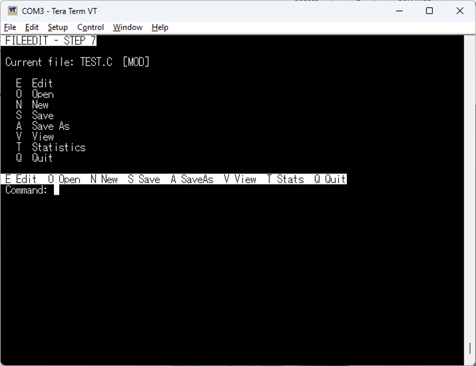
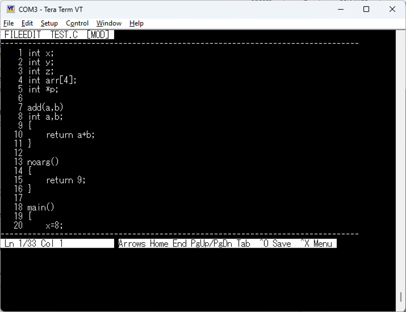

# FileEdit for the TMS9900/TMS99105 SBC

FileEdit is a small full-screen text editor for a TMS9900-family
single-board computer, designed for use through a VT100/ANSI terminal
such as Tera Term.

It began as **FILESTAT**, a technical tutorial project demonstrating a
resident kernel with mapped code overlays. It then evolved milestone by
milestone into an editor while retaining the original file-statistics
functionality.

## Current milestone

Current features include full-screen VT100/ANSI editing, a display-only
line-number gutter, cursor navigation, insertion/deletion, real ASCII
TABs, Open/New/Save/Save As, `[MOD]` dirty-state indication, rolling
`.BAK` backups, post-save verification, the original FILESTAT
statistics, seven generated OVL99 code overlays, and interrupt-buffered
TMS9902 receive input using a 64-byte resident ring.

`FILESTAT.EXE` is still produced as a byte-identical compatibility
alias, but **FILEEDIT.EXE** is the primary application.

## Screenshots

### FileEdit main menu



The main menu provides Edit, Open, New, Save, Save As, View, Statistics and Quit while retaining the current document in resident editor state.

### Full-screen editor with display-only line numbers



The editor runs directly in the VT100/ANSI terminal. The line-number gutter is rendered by `OVL_VIEW`; the numbers are not part of the document and are never saved. The status line shows the logical line/column and the principal navigation and save commands.

## Typical use

```text
FILEEDIT TEST.C /E    Open the full-screen editor
FILEEDIT TEST.C /S    Run file statistics
FILEEDIT /O           Test nested cross-overlay calls
```

`FILEEDIT /O` should report `OVL99 NESTED PASS` on the SBC. The current
`FILESTAT.C` command-line parser exposes these three modes; older tutorial
examples of `/L`, `/V` and `/I` are historical and are not current CLI modes.

## Editor keys

  Key           Action
  ------------- -----------------------------------
  Arrow keys    Move cursor
  Home / End    Start / end of logical line
  PgUp / PgDn   Move by a screen
  Tab           Insert a real ASCII `09` TAB
  Backspace     Delete character to the left
  Delete        Delete character under the cursor
  Enter         Split the line
  Ctrl-O        Save and verify
  Ctrl-X        Return to the FileEdit menu

Line numbers are rendered screen decoration. They are not stored,
editable, saved, or included in FILESTAT statistics.

## Architecture

```text
>1000-7FFF   resident FileEdit, OVCALL/OVLMGR, editor state, I/O, RX
>8000-8FFF   one OVL99-mapped code overlay at a time (segment 8)
>9000-BFFF   12 KB editor data window, physical pages 0 and 1
>C000-DFFF   shell page 0 / 8 KB editor data in page 1 while active
>E000-EFFF   BDOS (untouched by FileEdit)
>F000-FFFF   ROM / MONITOR
```

The document also uses safely claimed resident heap space between
banked regions. At runtime, editor capacity is `32767 + ebheapsz` bytes,
with a byte reserved for the trailing sentinel.

Overlay assignments:

``` text
page 2   OVL_WORD   statistics word/line pass
page 3   OVL_CHAR   character-class pass
page 4   OVL_RPT    report formatter
page 5   OVL_VIEW   viewer/editor frame renderer
page 6   OVL_EDIT   key decoding and editing operations
page 7   OVL_PASTE  terminal paste/edit handling
page 8   OVL_NAMEIO filename prompt
```

`OVLMAP.TXT` is the source of truth for module IDs, physical pages and
published entry names. `tools/ovlgen.ps1` and DREL produce the address
includes, overlay table and resident calling thunks (`OVLTHUNK.A99`).
Calls such as `viewfile()` and `editstep()` go through those thunks and
`OVCALL` rather than manually mapping overlays. The manager maintains
a 16-frame stack for nested overlay calls, and generated map validation
prevents code overlays from overwriting the data banks.

DREL also lints relocation chains and checks one-page overlay size limits.
The build checks that published overlay functions resolve to resident
thunks rather than directly to virtual overlay addresses.

## How transparent overlays work (without changing LINK99)

**The key distinction is that LINK99 already knew how to place R99 modules
in physical pages.** What FileEdit lacked was a stable, resident entry
point for each exported overlay function, together with a resident runtime
that could select the page and return through nested overlay calls.

We added that indirection *around* the existing Windows-hosted LINK99,
not inside the compiler or linker. From ordinary Small-C code, a call
such as `viewfile()` still looks like any other C function call.

### 1. Describe code ownership once

[`OVLMAP.TXT`](OVLMAP.TXT) declares a source module, its physical
page, a logical overlay name and its externally callable functions:

```text
OVL_VIEW   5  VIEW    viewfile
OVL_EDIT   6  EDIT    editstep
OVL_NAMEIO 8  NAMEIO  nmprompt
```

All seven FileEdit code overlays are linked to the **same virtual
segment 8**, `>8000–>8FFF`, but each has a **different physical page**.
Thus `>8000` by itself does not identify a callable function: the
runtime must know both the overlay identity and the function's entry
offset/address within the window.

### 2. Generate the build inputs in two phases

[`make_SBC_FileEdit99.ps1`](make_SBC_FileEdit99.ps1) invokes
[`tools/ovlgen.ps1`](tools/ovlgen.ps1) before and after DREL:

1. **Definitions:** `ovlgen -Phase defs` reads the map and generates
   `OVLDEFS.INC` (logical IDs) and `OVLDESC.TXT` (DREL module/page/
   exported-entry descriptors).
2. **Compile and inspect:** Small-C and R99 build the modules; DREL
   checks their relocation chains and generates `OVLADDR.INC`
   (exported overlay entry addresses) and `OVLTABLE.INC` (the
   segment-to-physical-page table).
3. **Resident thunks:** `ovlgen -Phase thunks` uses those generated
   addresses and IDs to produce `OVLTHUNK.A99`. The build assembles
   this alongside the resident `OVCALL.A99` and `OVLMGR.A99`.
4. **Ordinary link:** The unchanged Windows LINK99 links the resident
   objects and places each code module using its existing `-P`
   physical-page arguments (for example `-P5 OVL_VIEW.R99`).

Every public overlay function gets a small resident *thunk*. A
representative generated entry is:

```asm
viewfile:
    LI R1,OVL_VIEW
    LI R2,O_VIEWFILE
    B  @OVCALL
```

`O_VIEWFILE` comes from DREL; it identifies the real implementation
inside the `>8000` window. The public symbol `viewfile` belongs to
the **resident thunk**, which is always available. The final linker
symbol listing from the successful SBC build resolved `viewfile` to
resident address `>5462`, not into the overlay window.

Notice the **`B`**, rather than a new `CALL`. The thunk preserves the
return address and arguments established by the caller's ordinary C
call; `OVCALL` takes responsibility for eventually returning there.

### 3. Map, call and restore at runtime

[`src/resident/OVCALL.A99`](src/resident/OVCALL.A99) receives the
logical overlay ID in **R1** and the entry address in **R2**.

- If the required overlay already owns the window, it branches directly
  to the entry (fast path).
- Otherwise, it saves the original return address and the previous
  overlay owner on a **resident 16-frame stack**.
- It calls [`OVLMGR.A99`](src/resident/OVLMGR.A99), which selects
  the physical page through the existing CRU page registers and
  records the current owner in `CUR_WINA_ID`.
- It calls the real implementation using the normal Small-C ABI.
  On return it restores the previous overlay for an overlay caller,
  reinstates the original return address and returns normally. The
  function result in R4 survives the mapper.

The nested-call test proves why the return mechanism matters:

```text
Resident -> WORD (page 2) -> CHAR (page 3) -> RPT (page 4)
         <- restore WORD <- restore CHAR <- RPT result
```

More precisely, RPT returns to the restored CHAR page, CHAR returns
to the restored WORD page, and WORD returns to resident code. The
actual `FILEEDIT /O` test checks results **108 -> 109 -> 110** and
prints `OVL99 NESTED PASS` on the TMS99105 SBC.

### 4. Keep code mapping separate from editor data banking

The generated-overlay validator rejects a code overlay that attempts
to use a segment other than 8. That protects FileEdit's independent
[`EBMAP.A99`](src/resident/EBMAP.A99) data mappings at
`>9000–>BFFF` and the optional editor storage at `>C000–>DFFF`.
`>E000–>FFFF` (BDOS/ROM) is not remapped by FileEdit.

**An important restriction:** a pointer to a string, buffer or other
data *inside an overlay* must not be passed to another overlay that
replaces that same window while the pointer is in use. Persistent
cross-overlay data must live in resident or independently mapped
memory. Likewise, arbitrary cross-overlay branches that bypass thunks
are unsafe.

### 5. What LINK99 does—and what it does not yet do

This is **transparent calling**, not automatic function placement.

The existing linker resolves ordinary external symbols. Because the
generated exported names are defined by **resident thunks**, normal
C calls link to those thunks. The build verifies LINK99's reported
external references are to resident addresses, runs DREL chain checks,
and fails when a mapped code module exceeds the current one-page safe
budget (**4,032 bytes of a 4,096-byte page**).

There are still **manual module/page choices** in `OVLMAP.TXT`.
The tools do not automatically split a large C function, move individual
functions between modules, group frequently calling functions, or
synthesize arbitrary cross-overlay relocations. In the tested build,
`OVL_VIEW` and `OVL_EDIT` had only 26 and 36 safe bytes free,
respectively. Additional features may require intentionally splitting
modules or assigning new pages.

**Proposed next phase (not implemented):** extend the build tooling to
measure and allocate whole modules automatically, then investigate
function-level placement in LINK99/compiler object metadata, balancing
page capacity with call frequency. Keep this distinct from the
already-working OVL99 call gate.

**Evidence:** `FILEEDIT /O` passed on hardware, and FileEdit
successfully navigated, saved, reopened and backed up 16 KB and about
33 KB test documents across its data-bank boundaries. See
[`docs/OVL99_PHASE2.md`](docs/OVL99_PHASE2.md) for the test
procedure and
[`docs/OVL99_INT2_INVESTIGATION.md`](docs/OVL99_INT2_INVESTIGATION.md)
for the independently reproduced intermittent Shell `TYPE`/INT2
issue, which this integration does not claim to fix.

## TMS9902 receive architecture

Blocking console input worked until full-screen scrolling became
expensive enough for bytes of VT100 cursor-key sequences to be lost.
`ESC [ B`, for example, could be reduced to a lone `B` and inserted into
the document.

FileEdit now temporarily hooks the writable **INT4 handler PC at
`>0012`**, retaining the MONITOR's existing INT4 workspace at `>0010`.

``` text
Tera Term
   |
TMS9902
   |
INT4
   |
FileEdit RXISR
   |
64-byte resident ring
   |
TERMIO / ANSI decoder
   |
OVL_EDIT
```

The ISR is pure assembly: no C calls, BDOS calls, stack use, terminal
output, disk work, or overlay mapping. Because interrupt entry switches
workspace, it explicitly loads `R12` with the TMS9902 serial CRU base
`>0080`.

For a received byte it inhibits/acknowledges receiver interrupts with
`SBZ 18`, drains the receive buffer with `STCR`, queues the byte, and
re-arms the receiver with `SBO 18`.

FileEdit then **always chains to the previously installed INT4
handler**. The previous owner remains responsible for timer or other
INT4 work and performs the final `RTWP`. FileEdit therefore adds an RX
service without claiming exclusive ownership of INT4.

The original development notes include a standalone `/I` interrupt test.
The current OVL99 `FILESTAT.C` command-line driver does not expose that
historical diagnostic; use the editor's keyboard navigation to check
normal RX behaviour.

## Save safety

For an existing target FileEdit first makes a `.BAK`, writes the editor
contents, closes and reopens the file, and verifies it against the RAM
document. Dirty state is cleared only after verification succeeds.

## Building

The supplied Windows-hosted toolchain contains:

-   `smallcp.exe`
-   `r99.exe`
-   `drel.exe`
-   `link99.exe`

From the `fileedit/` directory run on Windows:

```powershell
powershell -ExecutionPolicy Bypass -File .\make_SBC_FileEdit99.ps1
```

Set `$env:FILEEDIT_SKIP_MONITOR_DEPLOY = "1"` when building without the
sibling monitor directory. `.github/workflows/ovl99-fileedit.yml` runs
the same build in Windows GitHub Actions.

The script stages inputs into `build\`, compiles resident modules and
overlays, runs DREL chain lint, generates overlay tables, checks
one-page overlay budgets, links, and writes:

``` text
dist\FILEEDIT.EXE
dist\FILESTAT.EXE
dist\SAMPLE.TXT
```

The script also deploys to a sibling MONITOR workspace. Adjust
`$MonitorDir` if your checkout layout differs.

## Repository layout

``` text
src\resident\      resident C and assembly modules
src\overlays\      mapped code overlays
OVLMAP.TXT         canonical overlay declarations
tools\ovlgen.ps1    generated overlay descriptors and thunks
lib\               runtime objects and libraries
tools\             compiler/assembler/DREL/linker
tests\             repeatable sample input
docs\              architecture and milestone notes
build\             disposable build directory
dist\              final executable output
```

## Hardware assumptions

The current build assumes a TMS9900-family/TMS99105-compatible SBC,
TMS9902 at serial CRU base `>0080`, its interrupt connected to CPU INT4,
writable interrupt vectors in common RAM, the MONITOR-provided INT4
workspace/timer service, the existing BDOS interface, and VT100/ANSI
terminal behavior compatible with Tera Term.

## Documentation

The repository deliberately preserves the development/tutorial history.
Particularly useful files are:

-   `docs/STEP6_3_OVLEDIT.TXT` --- introduction of the fifth overlay;
-   `docs/STEP7_FILEEDIT.TXT` --- FileEdit rename and display-only
    line-number gutter;
-   `docs/STEP7_1_INT4RX.TXT` --- interrupt-driven receive development;
-   `docs/MEMMAP.TXT` --- current memory and overlay map;
-   `EDITSTEP*.TXT` --- short hardware bench-test cards.

## OVL99 hardware verification (November 2026)

The TMS99105 SBC has reported `OVL99 NESTED PASS` for the test path
`Resident → WORD → CHAR → RPT → CHAR → WORD → Resident`.

After transfer to a replacement disk image, a regular document was edited,
saved, and automatically backed up. The modified main file and original
backup content were verified by reopening. A 16 KB regression document
crossing the 12 KB editor-bank boundary was navigated, edited on line 171,
saved, and reopened. `L16TEST.TXT` retained `X0171`; `L16TEST.BAK`
retained the original `0171`.

The user also concatenated two 16 KB tests into an approximately 33 KB
document. FileEdit navigated to EOF, then saved a copy as `L33TEST.TXT`,
changed the beginning of line 430, saved again, and reopened both files:
the main file retained `X0211` while `L33TEST.BAK` retained `0211`.
That exercises the adaptive heap plus shell-window data bank while
OVL99 controls the independent code-overlay window.

The Windows cross-build has passed. An intermittent `TYPE` / INT2 fault
has also been reproduced after SYSGEN **without FileEdit installed or
running**. Its cause remains unresolved, and it is tracked separately in
`docs/OVL99_INT2_INVESTIGATION.md`; it must not be reported as fixed by
these overlay tests.

For implementation and regression details, see `docs/OVL99_PHASE2.md`.
The original tutorial documentation is retained for historical context.

## Historical note

Internal source names such as `FILESTAT.C` are intentionally retained.
FILESTAT is the project's origin and remains the statistics subsystem;
renaming every internal module would add churn without improving the
architecture.
